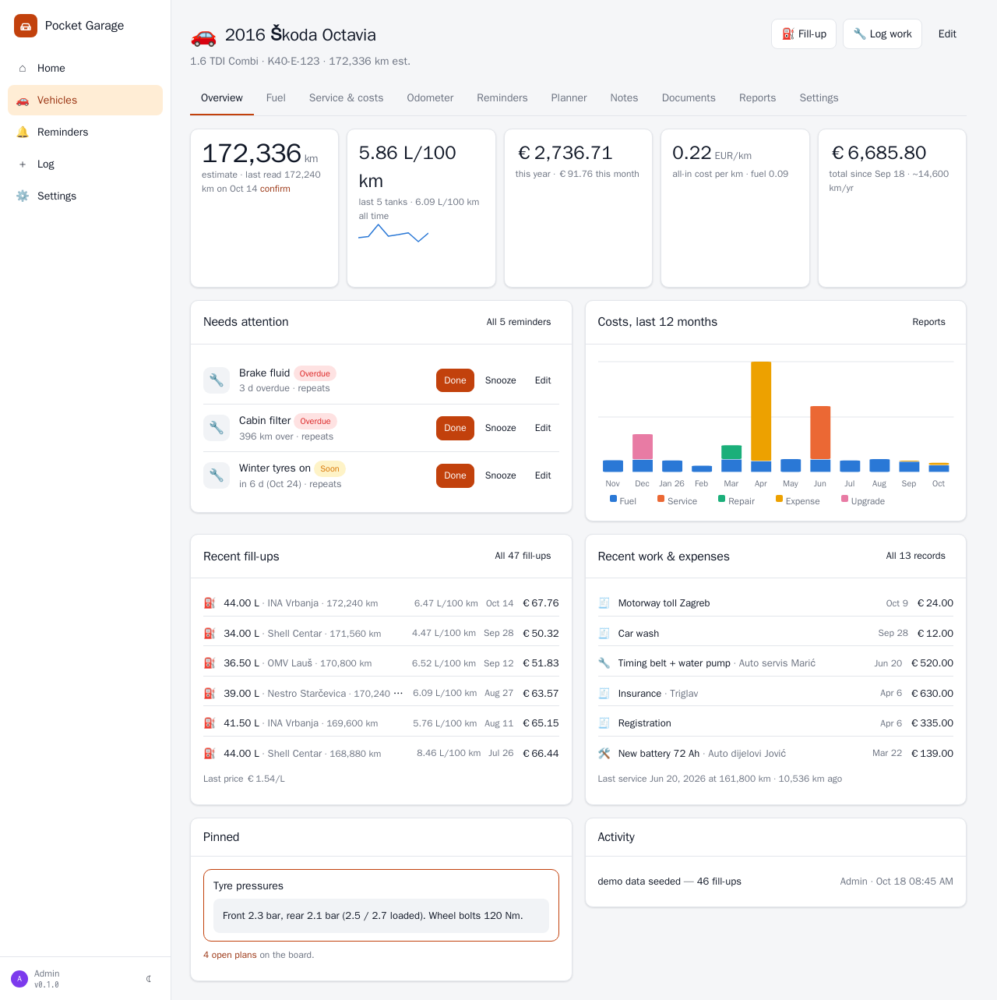
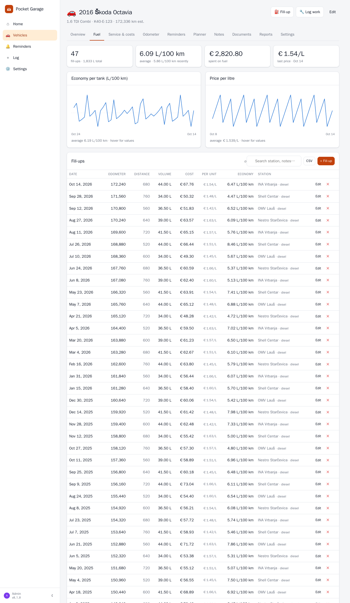
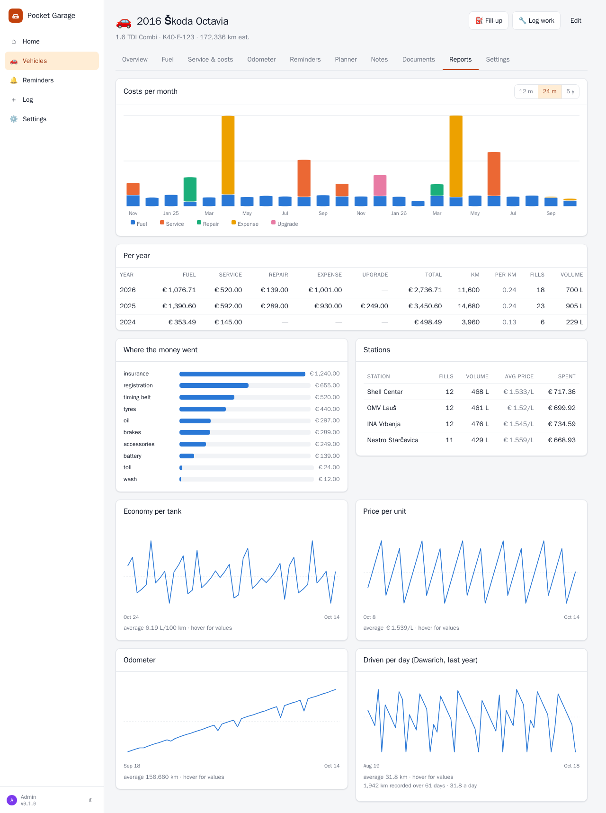
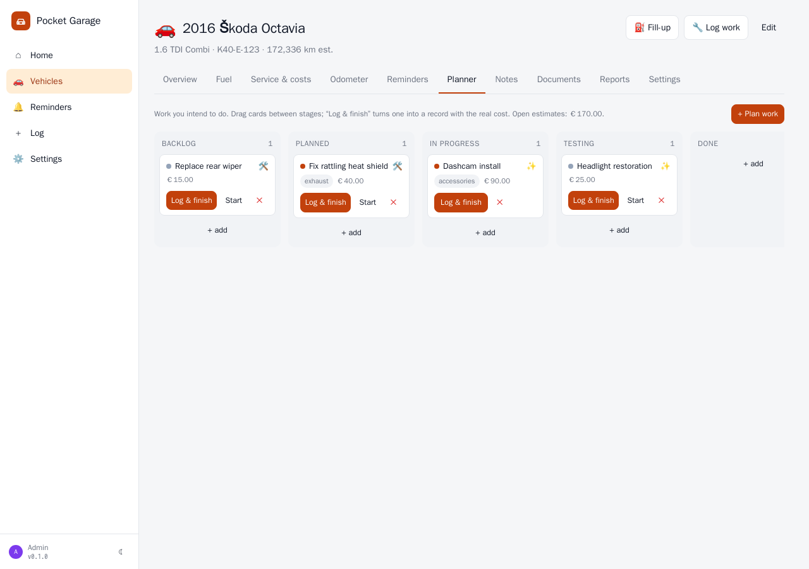
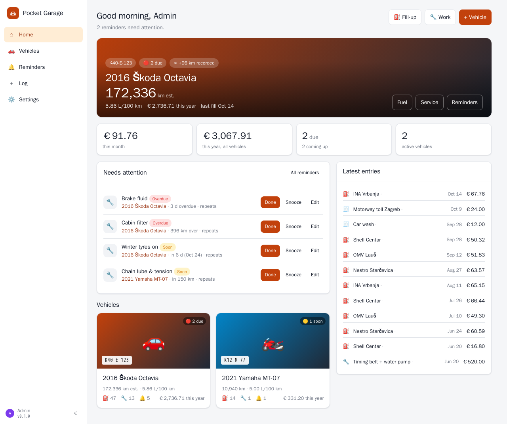
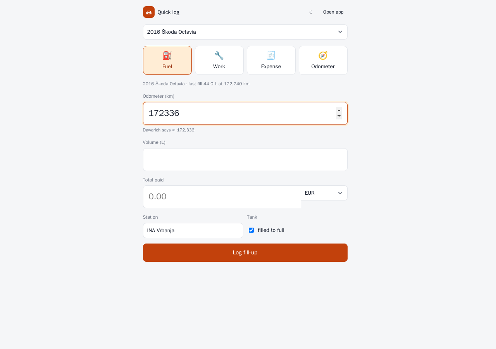

<p align="center">
  
</p>
<h1 align="center">Pocket Garage</h1>
<p align="center">
  Every vehicle on one page — fuel with real economy, service and repairs with the parts fitted, expenses, an odometer that estimates itself, reminders that roll forward, a planner, notes and documents — as a small self-hosted server.<br>
  <b>One binary · one SQLite file · one volume.</b>
</p>
<p align="center">
  <a href="https://github.com/abjelosevic88/pocket-homelab-garage/actions"></a>
  <a href="https://github.com/abjelosevic88/pocket-homelab-garage/pkgs/container/pocket-homelab-garage"></a>
  <a href="LICENSE"></a>
</p>

---

I kept the car in LubeLogger and liked the idea more than the app: the locale ate my decimal points, every record spawned a phantom odometer row, and the money lived somewhere else anyway. Pocket Garage does what LubeLogger does and fixes the parts that hurt, then plugs the car into the rest of the house:

- **Fuel that computes itself.** One row per fill-up. Distance, L/100 km (or km/L, mpg) and cost per km come from the previous full tank; partial fills roll into the next full one; a “missed one” flag keeps a gap from poisoning the numbers. Price per litre over time, per station.
- **One list for everything you paid.** Service, repairs, upgrades and plain expenses (registration, insurance, wash, tolls) with a kind, a category, the workshop and the **parts fitted** — quantities, part numbers, and names suggested from Pocket Inventory.
- **An odometer that is never typed twice.** Any fill-up or record with a reading *is* the odometer log. Between readings, **Dawarich** adds the kilometres you actually drove, so the dashboard shows an estimate and reminders by distance stay honest. Confirm it with one click when you glance at the dash.
- **Reminders that roll forward.** By date, by odometer, or whichever comes first; recurring intervals; *due soon / due / overdue*; logging the matching work completes them. Pushes through **Apprise, ntfy or a webhook**; an `.ics` feed for the phone's calendar.
- **Money that is real.** Tag the car's withdrawals in **Firefly III**; matching rows link to the fill-up or record you logged, the rest come in as expenses, and any row can be pushed back to Firefly as a withdrawal. Costs in any currency convert at the day's rate (euro pegs like BAM built in).
- **Everything else a car needs.** A planner board (backlog → done, “log & finish” turns a card into a record with the real cost), pinned notes, documents with expiry dates, a quick one-screen log page for the phone, reports per month and per year, CSV / JSON exports, trips from **Pocket Travel** with what the car cost during each.
- **A LubeLogger-compatible API.** The Pocket Homelab phone app and the Raycast extension keep working with only the base URL changed — form or JSON, comma or dot decimals, Basic auth with your own account. And a one-time **import from LubeLogger** that brings vehicles, photos, records, fuel, reminders, planner cards and notes across.

<p align="center"></p>

<table>
  <tr>
    <td width="50%"></td>
    <td width="50%"></td>
  </tr>
  <tr>
    <td align="center"><sub>Fuel: every fill-up with its stretch, charts for economy and price.</sub></td>
    <td align="center"><sub>Reports: per month, per year, per category, per station, odometer, driven per day.</sub></td>
  </tr>
  <tr>
    <td width="50%"></td>
    <td width="50%"></td>
  </tr>
  <tr>
    <td align="center"><sub>Planner: drag cards between stages; “Log & finish” records the real cost.</sub></td>
    <td align="center"><sub>Home: what needs attention across every vehicle, and the latest entries.</sub></td>
  </tr>
</table>

<p align="center">
  <br>
  <sub><code>/quick</code>: one screen for the fill-up at the pump, installable as a PWA shortcut.</sub>
</p>

## Features

| Area | What you get |
|---|---|
| **Vehicles** | Year, make, model, trim, plate, VIN, type (car, motorcycle, van, truck, camper, bike, boat, tractor), fuel type incl. electric and hybrids, odometer in km / miles / hours, tank size, currency, colour, photo, purchase and sale dates and prices, status active / sold / archived, tags, notes. Owner / editor / viewer per user. |
| **Fuel** | Date, odometer, volume (L / US gal / UK gal; kWh and state of charge for EVs), cost in any currency or price per unit, full tank, missed fill-up, station, grade, notes. Derived distance, economy (L/100 km, km/L, mpg US/UK), price per unit, cost per km. Search, CSV. |
| **Service & costs** | Kinds service / repair / upgrade / expense with categories (suggested from what you used), workshop, odometer, parts list with quantities, part numbers and inventory links, tags, notes; filter by kind, year, text; CSV. |
| **Odometer** | Readings from every source in one history with deltas; Dawarich driving km per day; estimate + confirm; km per year; CSV. |
| **Reminders** | Date and/or odometer, repeat every N days / km, warn-ahead windows, templates (oil, inspection, registration, insurance, tyres, brake fluid, coolant, timing belt…), done with optional record, snooze, auto-complete when matching work is logged, cross-vehicle list, notifications, iCal feed. |
| **Planner** | Kanban backlog → planned → in progress → testing → done, priority, estimate, target date, drag & drop, “log & finish”. |
| **Notes & documents** | Pinned notes on the overview; files with kind and expiry (insurance, registration, inspection…) that warn 30 days ahead. |
| **Reports** | Stacked costs per month (12 m / 24 m / 5 y), per-year table with km and cost per km, categories, stations, economy, price, odometer and Dawarich series. |
| **Integrations** | Firefly III (tag sync every 30 min, push withdrawals, default account and category), Dawarich (timeline driving km), Apprise / ntfy / webhook, Pocket Travel (trips with fuel and km), Pocket Inventory (parts lookup), LubeLogger import, LubeLogger-compatible API, Homepage dashboard endpoint, Prometheus `/metrics`. With **Pocket Core** on the box: registers itself, publishes `garage.fuel_logged`, `garage.service_logged` and `garage.odometer_updated`, accepts paired-phone tokens, finds its siblings without `*_URL` settings, and shows “Sign in with Pocket Core” on the login page with no OIDC configuration at all. |
| **Users & ops** | Built-in login (admin/member), OpenID Connect sign-in (Pocket Core, PocketID…), SSO-proxy header, or no login on a trusted LAN. API tokens. SQLite backup from the UI/CLI/API, JSON export/import per vehicle. |

## Run it

```bash
mkdir pocket-garage && cd pocket-garage
curl -fsSLO https://raw.githubusercontent.com/abjelosevic88/pocket-homelab-garage/main/docker-compose.yml
docker compose up -d
# open http://localhost:8080 and create your account
```

Or with plain Docker:

```bash
docker run -d --name pocket-garage -p 8080:8080 -v $PWD/data:/data ghcr.io/abjelosevic88/pocket-homelab-garage:latest
```

Or the binary from the [releases](https://github.com/abjelosevic88/pocket-homelab-garage/releases) (Linux, macOS, Windows, FreeBSD): `DATA_DIR=./data ./pocket-garage`. A systemd unit is in `deploy/systemd/`.

### Coming from LubeLogger

Set `LUBELOGGER_URL` (and username/password if it has an account) before the first start and everything is imported while the database is still empty — or do it later under **Settings → Import**, per vehicle, re-runnable. Then point the Pocket Homelab app and the Raycast extension at the new URL and sign in with your Pocket Garage email and password.

### Integrations

All optional, all under **Settings → Integrations** (or environment variables, see [docs/configuration.md](docs/configuration.md)):

- **Firefly III** — URL + personal access token; set a tag per vehicle under its Settings tab.
- **Dawarich** — URL + API key; switch it on for the vehicle you drive with the phone that records.
- **Notifications** — an Apprise gateway endpoint, an ntfy topic URL or any JSON webhook; pick the hour.
- **Pocket Travel / Pocket Inventory** — URL + an API token from each app.

## Documentation

- [Configuration](docs/configuration.md) — every environment variable, auth modes, CLI
- [API](docs/api.md) — REST API, the Homepage dashboard, the LubeLogger-compatible endpoints
- [Reverse proxy](docs/reverse-proxy.md) — Caddy, Traefik, nginx, forward auth, a one-tap fuel hostname
- [Backup & restore](docs/backup.md)
- [Roadmap](docs/roadmap.md)

## Develop

```bash
make dev      # Go API on :8080 with demo data + Vite on :5173
make test     # go vet, go test, tsc
make          # build web/dist and the binary
make docker   # local image
```

Go 1.26 + chi + modernc SQLite (pure Go, no CGO); React 19 + Vite + TypeScript, no UI framework. Everything is in `internal/` (store, server, integrations) and `web/src/`.

## Sibling projects

Pocket Garage is one of the Pocket Homelab apps — small single-binary servers that talk to each other: [Pocket Habits](https://github.com/abjelosevic88/pocket-homelab-habit-tracker), [Pocket Inventory](https://github.com/abjelosevic88/pocket-homelab-inventory), [Pocket Bookshelf](https://github.com/abjelosevic88/pocket-homelab-bookshelf), [Pocket Split](https://github.com/abjelosevic88/pocket-homelab-cost-split), [Pocket Clips](https://github.com/abjelosevic88/pocket-homelab-clips), [Pocket Travel](https://github.com/abjelosevic88/pocket-homelab-travel).

## License

MIT — see [LICENSE](LICENSE).
